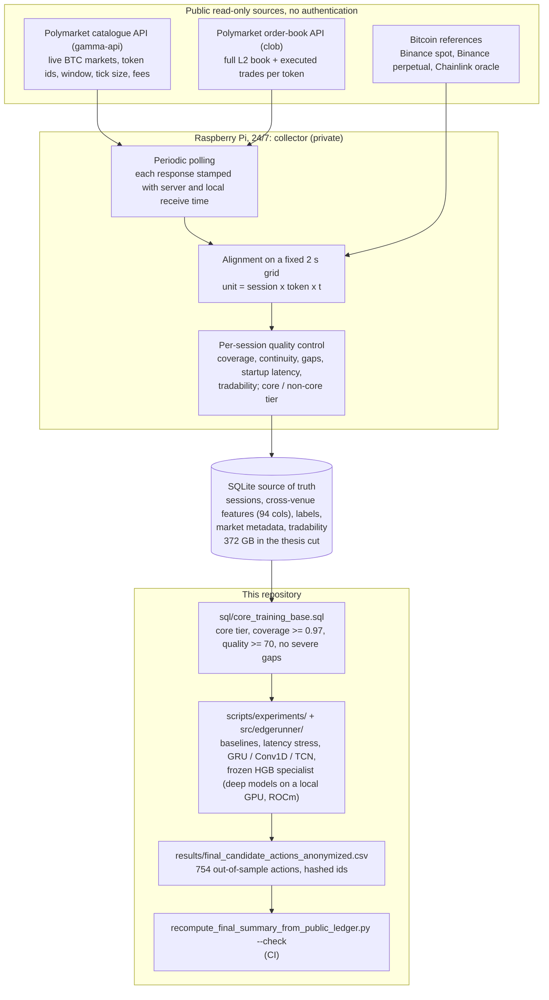

# Polymarket BTC — short-horizon microstructure and prediction

[](https://github.com/marcmaldonadolorca/polymarket-btc-microstructure/actions/workflows/tests.yml)

> Master's thesis (MSc in Deep Learning, UPM, 2025/26), **graded 10/10**.
> Author: **Marc Maldonado Lorca**.
>
> This repository accompanies the thesis. It documents a full methodology for
> data capture, temporal validation and cost control for BTC markets on
> Polymarket, and the **model ladder** that runs from a tabular baseline to a
> frozen specialist and a subsequent regime-change diagnosis.

## TL;DR

- **Data engineering on my own infrastructure.** A collector I wrote has run 24/7 for months on a
  Raspberry Pi: it polls Polymarket's public order-book and market-catalogue APIs, adds Bitcoin
  spot, perpetual-futures and oracle references, aligns everything on a fixed 2-second grid and
  applies per-session quality control before writing to SQLite. **372 GB in the thesis cut
  (17 Aug 2026)**. See the [architecture diagram](#capture-and-data-architecture).
- **An honest ML result.** A tabular baseline calls the price direction right ~90% of the time
  (90.1% over 578 actions in 4 temporal folds) and still loses money: with a realistic 2 s entry
  latency, net on the terminal test drops from +6.79 (zero latency) to **−1.48 ticks per action**. Sequence
  models over the order book (GRU, Conv1D, TCN, fusion) learned representations, not a better
  policy. Cost and latency decide, not accuracy.
- **Evaluation discipline.** Strictly temporal splits; a specialist frozen before it saw 5
  untouched days (+0.349 ticks per action, 754 actions, 3/5 positive days); post-hoc analysis
  labelled as such; the evaluation protocol pre-registered with a timestamp on the Bitcoin
  blockchain.
- **Auditable in one command, without the private corpus** (also runs in CI):

  ```bash
  python scripts/experiments/recompute_final_summary_from_public_ledger.py --check
  # Base OOS @0.5: n=754, mean=+0.349
  # Low-vol post-hoc @0.5: n=318, mean=+1.069
  # Market-cluster IC90: [+0.193, +2.004]
  # Public ledger check: OK
  ```

## What it is and what it isn't

This is a **methodological, academic** work. It is not a production trading
system and **makes no claim of real profitability**. All results are reported in
**net ticks** (not dollars or ROI) and always with their support (number of
trades and days) and their uncertainty.

The out-of-sample validation is **5 days** (6–10 June 2026). The base specialist
was frozen before that block; the volatility filter was proposed after observing
the regime change and is reported as a post-hoc analysis. Distinguishing the two
kinds of evidence is central to the work.

## The core lesson

```text
A tabular baseline gets direction right ~90% of the time at 16 s... and still
loses money. With a realistic 2 s entry latency, net on the terminal set drops
to -1.48 ticks. Getting the direction right is not winning: cost and latency
decide. The whole project is reorganized around this lesson.
```

## The model ladder (the project's arc)

The narrative follows an incremental model progression, requiring at each step
that the added complexity be justified by evidence
(baseline → linear → features → deep model → final model):

```text
tabular baseline H16 (90% dir., looks excellent)
  -> dies with realistic latency (-1.48 ticks at 2 s)          [CORE LESSON]
  -> latency-aware models (AUC 0.79, negative economic policy)
  -> sequences + order book (GRU, Conv1D, fusion, TCN): representation yes, policy no
  -> methodological correction of the adverse score            [RIGOR]
  -> strict OOF protocol + horizon selection (H60 lives, H120/H240 collapse)
  -> prestart H60 specialist FROZEN before seeing fresh data
  -> clean OOS, 5 days: +0.349 ticks/action @0.5, 3/5 positive days
  -> post-hoc diagnosis: regime change and volatility filter
  -> diagnostic subset: +1.069 ticks/action, 5/5 days (non-confirmatory)
  -> regime-adaptation experiments: all NO_GO (valuable negatives)
  -> offline shadow replay + prospective validation design
```

## Out-of-sample result and post-hoc diagnosis

The prestart H60 specialist (HistGradientBoosting: EV regressor + "healthy"
session classifier) was first evaluated with no decided filter on the new block:

```text
clean OOS: n = 754 units, 5 days (6-10 Jun 2026)
Net@0.5 = +0.349 ticks/unit; 3/5 positive days
Sensitivity: @0.25 = +0.537   @0.5 = +0.349   @1.0 = -0.026

post-hoc low-volatility diagnosis: n = 318
Net@0.5 = +1.069; 5/5 positive days
Market-clustered 90% CI = [+0.193, +2.004]
Status = FROZEN HYPOTHESIS PENDING PROSPECTIVE VALIDATION
```

The full policy is frozen **after** the diagnosis and is not retrained to improve
these numbers. Only later dates can validate it (see
[`config/frozen_policy_thresholds.yaml`](config/frozen_policy_thresholds.yaml)).


## Capture and data architecture

What the collector does, as described in the thesis (Chapter 3, *Sistema de captura
multifuente*) and in the published schema ([`sql/core_training_base.sql`](sql/core_training_base.sql),
[`docs/01_sistema_de_datos.md`](docs/01_sistema_de_datos.md)). The collector's own code is
**not published**: it is coupled to the private host it runs on, and Chapter 7 (*El recolector,
y por qué no se publica*) explains why. The schema, the processing pipeline and an anonymised
ledger are.



The order-book API returns only the current book, not its history, so the corpus cannot be
re-downloaded: it exists because it was observed live. That is why it is not reproducible from a
script and why the public audit path goes through the anonymised ledger.

## Repository structure

```text
config/         Frozen policy thresholds + arc configs
docs/           18 canonical arc documents (01..18), renamed
notebooks/      9 pedagogical/audit notebooks (EDA, splits, target, baseline,
                latency, sequences, adverse correction, specialist, final ledger)
scripts/        Reproducible entrypoints (scripts/experiments/)
src/edgerunner/ Package with the shared logic (data, features, models, eval)
results/        key_results.csv and decision_register.csv filtered to the arc
sql/            Schema of the base training query
data/samples/   Contract and documentation of the published data
reports/        Canonical thesis (`memoria.pdf`) and official LaTeX source
```

## Reproducibility

```bash
python -m venv .venv && source .venv/bin/activate   # (Windows: .venv\Scripts\activate)
pip install -r requirements.txt
```

The scripts in `scripts/experiments/` are the arc's entrypoints. By design they
expect to run from the repository root (they resolve relative paths). The full
dataset (~2.6M cross-venue feature rows for the modelling arc, and the collector's
SQLite source, 372 GB by the 17 Aug 2026 cut) is **not published** due to size. The repository includes the schema (`sql/`), the code and an anonymized
ledger of 754 units in `results/final_candidate_actions_anonymized.csv`, enough
to recompute the final tables and the clustered uncertainty. Full training is not
reproducible without the private corpus and is declared as a limitation.

Key documents to understand the pipeline, in order (written in Spanish):
`docs/01_sistema_de_datos.md` -> `docs/04_splits_validacion_temporal.md` ->
`docs/07_stress_de_latencia.md` -> `docs/14_especialista_prestart_h60.md` ->
`docs/16_validacion_fresh.md` -> `docs/18_paper_shadow.md`.

The reading guide for `docs/` is [`docs/README.md`](docs/README.md), which opens with an
**English summary** of what each canonical document covers, which internal artifacts are not
published and how to audit the final numbers. The thesis itself
([`reports/memoria.pdf`](reports/memoria.pdf)) is in Spanish with an English abstract.

The final audit does not need the private corpus:

```bash
python scripts/experiments/recompute_final_summary_from_public_ledger.py --check
```

It is also available as a notebook in
`notebooks/08_auditoria_final_ledger.ipynb`.
The notebooks guide is in `notebooks/README.md`.

Unit tests cover the frozen policy thresholds, the decision gates and the cost model
(`src/edgerunner/`). They need only numpy, pandas and PyYAML, and GitHub Actions runs them
together with the ledger check on every push
([`.github/workflows/tests.yml`](.github/workflows/tests.yml)):

```bash
pip install numpy==2.4.1 pandas==3.0.2 pyyaml pytest -e .
pytest -q tests/
```

## Status and future work

Research **paused** as of the submission date. Open lines: prospectively validate
the full policy without touching thresholds, define a maximum per-market
exposure, test the U-shaped pattern (hypothesis) and revisit deep learning with
60+ days of data.

## License

MIT — see [`LICENSE`](LICENSE).
